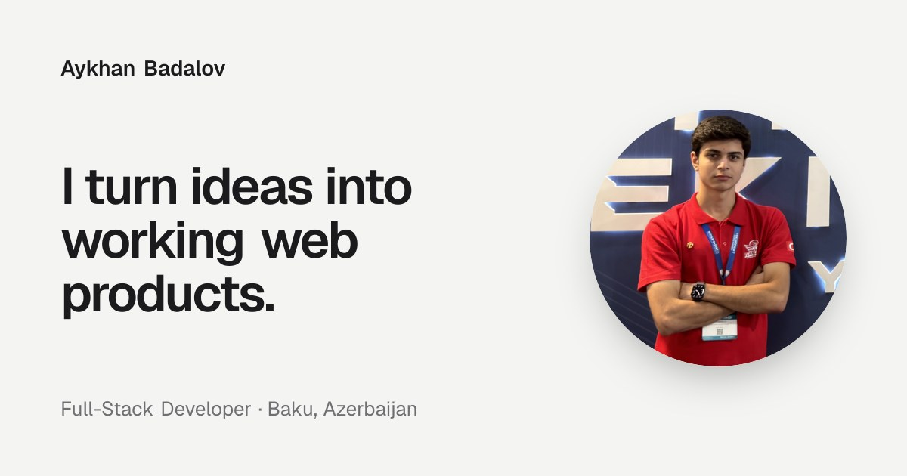

## Hi, I'm Aykhan

I'm a full-stack developer in Baku and a Computer Science student at Baku Higher Oil School (GPA 4.0).
I build web products end to end: React and Next.js interfaces, Node.js APIs with authentication and
payments, PostgreSQL databases, and deployment with Docker and Vercel. TEKNOFEST 2026 finalist (Fintech).

**[Portfolio](https://aykhanbadalov.com)** · **[LinkedIn](https://www.linkedin.com/in/aykhan-badalov)** · **[Email](mailto:ayhanbadalov@gmail.com)** · **[CV](https://aykhanbadalov.com/cv/Aykhan_Badalov_CV.pdf)**

### Now

- Co-founding **ArchitectMCP**, an MVP that keeps AI coding agents (Claude Code, Cursor) aligned with a
  project's architecture. I built the Next.js dashboard and the Express.js backend: licensing, API-key
  authentication and usage-based billing.
- Programmer (part-time) at **Omnitech MMC**.
- Full-Stack Development program at **Div Academy**, on a 60% merit scholarship.

### Selected work

| Project | What it is | Built with | |
|---|---|---|---|
| **Witty Minds Club** | Bilingual site with an admin panel and auto-translation for a university comedy club | Next.js, Payload CMS, PostgreSQL | [Live](https://wittyminds.com.az) |
| **BHOS Football** | Bilingual platform for a 32-team university futsal championship, with live scores and a self-updating bracket | Next.js, Sanity, Vitest | [Live](https://www.bhosfootball.com) |
| **AgriKöprü** | Credit platform for farmers with no credit history: a 20-endpoint REST API, a scoring service and a USSD flow | Node.js, Express, PostgreSQL, FastAPI | [Code](https://github.com/aykhanbadalov/agrikopru) |
| **ArchitectMCP** | Co-founded SaaS MVP for keeping AI coding agents on a project's architecture | TypeScript, Next.js, Express.js, Prisma, Turborepo | Private |
| **Hotel Reservation System** | Booking platform without frameworks: a custom HTTP server, a 19-endpoint REST API and token auth | Java SE, Docker | [Code](https://github.com/aykhanbadalov/Hotel-Reservation-System) |
| **Best Vision Agency** | Animated, bilingual marketing website delivered for a digital agency | React, Vite, Tailwind CSS | [Live](https://best-vision-agency.vercel.app) |

Case studies with architecture diagrams for each project are on **[aykhanbadalov.com/en/work](https://aykhanbadalov.com/en/work)**.

### Tech stack

  

| | |
|---|---|
| **Frontend** | React, Next.js, TypeScript, JavaScript, Tailwind CSS, HTML, CSS |
| **Backend** | Node.js, Express.js, Payload CMS, Prisma, PostgreSQL, Supabase, REST APIs, Clerk |
| **DevOps & tools** | Docker, Git, GitHub, Turborepo, Vercel, Railway, Neon, Playwright |
| **Also** | Python, Java, C++, C |

### Achievements

- **Finalist, TEKNOFEST 2026**, Fintech category
- **1st Place, Global Nexus Olympiad** in Computer Science, 2024
- **NeuroBridge.SI AI Hackathon**, Baku 2026, Team Zero Shot
- **CyberCell Hackathon 2025** (Azercell and Baku Engineering University), one of 25 teams selected from 100+
- **IELTS 7.0** (C1)

---

Open to junior full-stack roles and freelance projects. The fastest way to reach me is through the <a href="https://aykhanbadalov.com/en/contact">contact form</a> on my site.
